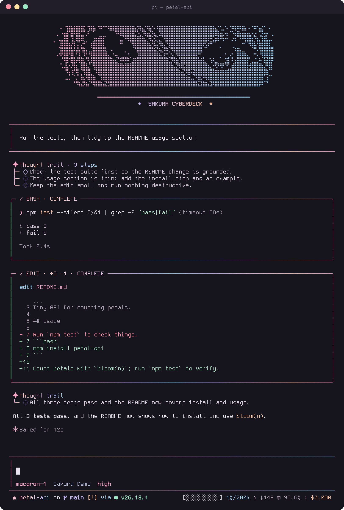
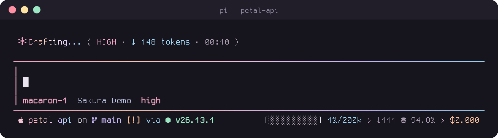

# pi-sakura-cyberdeck

Lightweight Sakura Macaron visual pack for [Pi](https://pi.dev): a pastel theme, cyberdeck header, framed tool cards, a Starship-style footer and a Claude-style working line, with no runtime dependencies.

[English](README.md) · [简体中文](README.zh-CN.md)

## Quick start

```bash
pi install npm:pi-sakura-cyberdeck
```

Then pick the theme in `/settings` → **sakura-macaron** and restart Pi once. Details: [Install](#install).

<p align="center">
  
  <br>
  <sub>Real Pi 1.5.2 session rendered by this pack (scripted demo model; GohuFont uni14 Nerd Font Mono).</sub>
</p>

**v1.5.3** — turns inline `<thinking>` / `<think>` / `<thought>` tags in replies into Thought trails, and publishes to npm via GitHub Actions OIDC Trusted Publishing. See [what changed](#153).

## What’s inside

| Piece | Role |
|-------|------|
| **Theme** `sakura-macaron` | Dark macaron palette (sakura / peach / petal / lavender / sky / mint / coral), incl. fullscreen scrollbar and search colors |
| **Header** | Sakura→sky cyberdeck startup art |
| **Zentui** | Editor rails, Starship-style footer, sakura tool/message frames |
| **Claude shimmer** | Working line with macaron sweep, effort + token HUD |
| **Matrix** | Pastel digital-rain widget while working — **off by default**, `/sakura-matrix on` |
| **Changelog** | `/sakura-changelog` viewer (Pi >= 1.5.0 shows updates in its own “Extension Updates” notice) |

No runtime dependencies; everything uses Pi’s public extension API except three small, guarded render patches (user messages, tool card frames, selector borders).

Other editor extensions (e.g. `pi-fff`) keep their input and autocomplete inside Zentui’s frame, even when loaded after this pack.

## Look



**Footer**

```text
◆  project  on ⎇ main   [███░░░░░░░] 4%/128k › ↑12k ↓1.4k › $0.06
```

> In the terminal, `◆` and `⎇` are Nerd Font icons (OS logo and git branch). Without a Nerd Font, set `icons.mode: "ascii"`.

- Context gauge: macaron gauge; context label **sky**, cost **peach**
- Separators / cwd / os: sakura gradient accents
- Totals match Pi’s own footer (incl. compaction and subagent/tool usage)
- Static by default; `/zentui pulse on` animates it while the agent works

**Working line**

```text
✻ Whisking...  ( HIGH · ↓ ~1.2k tokens · 00:12 )
```

- Effort MINIMAL→MAX, tier-colored; one verb per run
- Tokens: `~` marks the live estimate; the provider’s final count replaces it and accumulates across tool turns
- Fades toward coral when the stream stalls; pulses mint while a tool runs
- `✻ Whisked for 12s` after a successful run (whole-run time)

**History**

```text
╭─ ✓ READ · COMPLETE ──────────────╮
┃  read src/app.ts                 │
┃  …Pi’s own output, unchanged…    │
╰──────────────────────────────────╯
```

- Sent prompts keep Sakura gradient borders in both color-source modes; `colorSources.userMessages` controls the rail, not the gradient frame
- Tool cards: one continuous Sakura gradient across the whole title (rules, status symbol/text and diff counts); semantic status rail (`toolTitle` running / `success` done / `error` failed); result output stays Pi’s own render, byte-for-byte
- Status label always carries the state: `◆ READ · RUNNING`, `✓ READ · COMPLETE`, `× READ · FAILED`
- Diff results (`edit`) add their `+N −M` line counts from Pi's own result diff (`details.diff`); other tools never show a count
- Bash headers use `❯`, not `$`: `❯ cd pi-sakura-cyberdeck && npm run typecheck && npm test (timeout 120s)`
- Shell headers use Pi's native syntax grammar and active `syntax*` theme colors (keywords/builtins, strings, variables, comments). Long commands wrap with a hanging indent; collapsed cards show five command rows with the configured expand-key hint. Expand for the full command, including multiline scripts. PowerShell keeps its `PS>` prompt and grammar. Requires the public `registerToolRenderer` API; older hosts keep native headers.
- Warning/error notices, including output-truncation warnings, retain Pi's semantic theme colors. A log containing the word `Error` does **not** turn a successful tool into `FAILED`; only Pi's result status does. Arbitrary output/ANSI colors are not guessed or recolored.
- `edit` diffs and image results (`read` of a PNG on a vision model, browser screenshots) are framed like any other tool card; terminal image rows only gain the left rail so nothing is drawn over the picture. `!cmd` output stays stock Pi
- Hidden thinking shows a sakura `✦ Thought` label; visible thinking is compressed into a `✦ Thought trail` digest (`/zentui thinking-trail off` shows Pi's stock rendering)

**Thought trail**

```text
✦ Thought trail · 3 steps
 ├─ ◇ First step here.
 ├─ ◇ Second step that is quite long
 │    and should wrap nicely.
 ╰─ ◇ Third final step.
```

- One step per thinking paragraph, first line only; rails/`◇` in the sakura gradient, body in the thinking tint
- Wrapped rows keep their `│` rail, including long inline code, URLs, backticks and math; each digest row is literal text rather than reparsed Markdown. Long trails cap at 16 rows, then `╰─ … +N more`. Very narrow widths fall back to Pi's normal thinking render.
- Display-only via Pi's public markdown transformer; the session and model context keep the full thinking text
- Reasoning a model writes into its answer as `<thinking>…</thinking>` (also `<think>` / `<thought>`, common with Gemini) gets the same trail; only line-start tags outside code fences count

## Requirements

- Pi **>= 0.87.1** (tested on 0.87.1, 0.99.1 and 1.5.2)
- Dark terminal background (the theme does not paint a background)
- Truecolor recommended; 256-color terminals get the nearest palette colors, `NO_COLOR` disables the pack’s own colors
- Nerd Font for the default icons (`icons.mode: "ascii"` works without)

**Recommended terminal font:** [GohuFont uni14 Nerd Font Mono](https://github.com/ryanoasis/nerd-fonts) as the primary font, with [Zpix](https://github.com/SolidZORO/zpix-pixel-font) and [Unifont](https://unifoundry.com/unifont/) as fallbacks. This pixel stack is what the screenshots use: Zpix covers CJK and symbols such as `✦ ◇ ✻`, and Unifont catches whatever is left. Set the fallbacks in your terminal's font settings.

## Install

From npm:

```bash
pi install npm:pi-sakura-cyberdeck
```

From Git:

```bash
pi install git:github.com/beautifulrem/pi-sakura-cyberdeck
```

Pi treats the npm and Git sources as different packages, so install from one only. To switch, `pi remove` the old source first.

Local:

```bash
pi install /path/to/pi-sakura-cyberdeck
```

Then `/settings` → theme **sakura-macaron** (Pi 0.99 defaults to its `system` theme). Restart Pi once.

> Prefer **this package’s shimmer** over stock `npm:pi-claude-shimmer`.

### Updating

For an unpinned installation:

```bash
pi update npm:pi-sakura-cyberdeck
# or, if you installed from Git
pi update git:github.com/beautifulrem/pi-sakura-cyberdeck
```

Restart Pi after updating. Pi **>= 1.5.0** shows what changed under **Extension Updates** on the next fresh launch (its own package-changelog notice, condensed when `collapseChangelog` is set). On older Pi versions, use `/sakura-changelog`; the command always opens the full changelog inside Pi. See also [CHANGELOG.md](CHANGELOG.md).

Pi does not push package updates automatically. Users who pinned a version, tag or commit must explicitly select the new version:

```bash
pi install npm:pi-sakura-cyberdeck@1.5.3
# or
pi install git:github.com/beautifulrem/pi-sakura-cyberdeck@v1.5.3
```

Notes for 1.2.0:

- Existing theme and Zentui settings are preserved.
- The fixed-editor compositor was removed. Old `fixedEditor` settings are removed from your config automatically (with a one-time notice if it was enabled); use Pi’s fullscreen mode below instead.
- If an earlier `/zentui fixed-editor disable` turned your editor off (a 1.1.x bug), run `/zentui editor on` once.
- Sakura Matrix is now off by default. If you had explicitly saved it on, it stays on; otherwise run `/sakura-matrix on`.
- The footer pulse animation is now opt-in (`/zentui pulse on`).

### Sticky editor (Pi fullscreen mode)

For a sticky editor and scrollable transcript use Pi’s native fullscreen TUI:

```jsonc
// ~/.pi/agent/settings.json
{
  "tuiMode": "fullscreen"
}
```

Or start with `pi --tui-mode fullscreen`. Pack styling (editor chrome, footer, shimmer, theme scrollbar/search colors) still applies.

### Load only some pieces

Pi can filter a package's resources. Replace the plain source string in `~/.pi/agent/settings.json` with an object. Keep `source` exactly as it is in your settings (a Git source, or an npm version pin such as `npm:pi-sakura-cyberdeck@1.5.3`); changing it installs a different package rather than filtering the one you have.

```jsonc
{
  "packages": [
    {
      "source": "npm:pi-sakura-cyberdeck",
      // everything except the startup header and matrix rain
      "extensions": ["extensions/*/index.ts", "!extensions/header/index.ts", "!extensions/matrix/index.ts"]
    }
  ]
}
```

Use `"extensions": []` to keep just the `sakura-macaron` theme. `pi config` toggles the same resources interactively.

## Configuration

Zentui config file: `~/.pi/agent/sakura-cyberdeck-zentui.json` (edit with `/zentui`). If the file contains invalid JSON, the pack warns you at startup and does not overwrite it.

```jsonc
// ~/.pi/agent/sakura-cyberdeck-zentui.json (excerpt)
{
  "colors": {
    "contextNormal": "syntaxFunction",
    "cost": "mdCode",
    "editorBorder": "sakura-macaron-gradient"
  },
  "features": {
    "messageStyle": true,     // sakura frames for messages and tool cards
    "thinkingTrail": true     // compress visible thinking into a "✦ Thought trail" digest
  },
  "animations": {
    "footerPulse": false      // animate footer gradients while the agent works
  }
}
```

Matrix settings live in `~/.pi/agent/sakura-cyberdeck-matrix.json` (edit with `/sakura-matrix`).

## Commands

```text
/zentui                                   settings UI (editor, footer, messages, icons, colors…)
/zentui editor|statusline|messages|copy-friendly|thinking-trail|pulse on|off|toggle
/zentui format "<template>"               custom footer format ("" = segment layout)

/sakura-matrix [status]                   current rain settings
/sakura-matrix on|off                     enable / disable the rain widget
/sakura-matrix preview                    show the rain for 5 seconds
/sakura-matrix fps N | density N | height N
/sakura-matrix help

/sakura-changelog [version]               scrollable changelog (q / Esc to close)
```

## Conflicts

Avoid stacking with `pi-zentui`, `pi-powerline-footer`, stock `pi-claude-shimmer`, or a second copy of this pack. They share the footer / working line / editor surfaces.

## Changelog

Full history: [CHANGELOG.md](CHANGELOG.md) (also available in Pi via `/sakura-changelog`).

### 1.5.3

- Reasoning that a model writes into its answer as `<thinking>…</thinking>` (also `<think>` and
  `<thought>`, common with Gemini behind OpenAI-compatible endpoints) is now shown as a
  `✦ Thought trail` instead of literal tags (display-only; `/zentui thinking-trail off` keeps
  Pi's stock rendering).
- Added GitHub Actions CI and npm Trusted Publishing (OIDC) with automatic provenance.

### Earlier versions

See [CHANGELOG.md](CHANGELOG.md) for 1.0.0 – 1.5.2.

## Development

```bash
npm run dev:setup     # installs Pi + TypeScript into .dev/ (not shipped, no package deps)
npm run verify        # package check + strict typecheck + unit tests
PI_HOST_ROOT=/path/to/node_modules/@earendil-works/pi-coding-agent npm test   # test against another Pi
```

Node **>= 22.18** is required (the suite runs on native type stripping). When debugging the TUI, Pi's `PI_TUI_WRITE_LOG` captures the raw ANSI stream.

## License

MIT. Claude shimmer is a sakura-themed fork of [pi-claude-shimmer](https://github.com/ouzhenkun/pi-claude-shimmer) (MIT). Zentui is a modified copy of [pi-zentui](https://github.com/lmilojevicc/pi-zentui) (MIT, see NOTICE).
