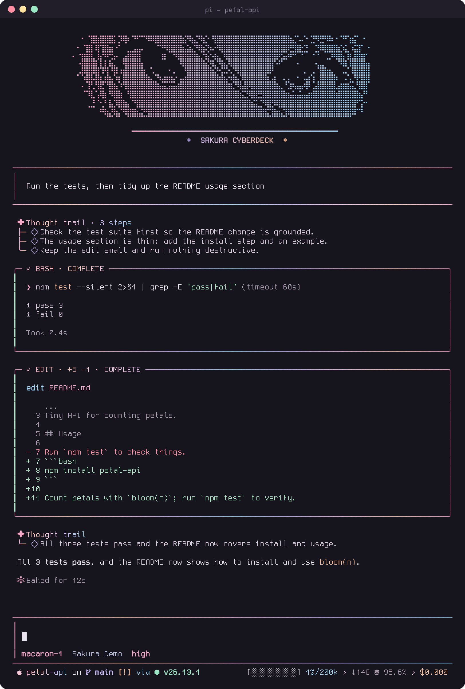
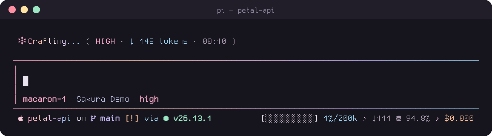

# pi-sakura-cyberdeck

给 [Pi](https://pi.dev) 编码代理做的轻量樱花马卡龙视觉包：粉彩主题、cyberdeck 启动画面、带边框的工具卡片、Starship 风格底栏和 Claude 风格的工作状态行，没有任何运行时依赖。

[English](README.md) · [简体中文](README.zh-CN.md)

## 快速开始

```bash
pi install npm:pi-sakura-cyberdeck
```

也可以从 Git 安装：`pi install git:github.com/beautifulrem/pi-sakura-cyberdeck`。两种来源 Pi 会当成两个不同的包，只装一个；要换来源，先 `pi remove` 旧的。

然后在 `/settings` 里把主题选成 **sakura-macaron**，重启一次 Pi。

<p align="center">
  
  <br>
  <sub>由本包渲染的真实 Pi 1.5.2 会话（演示用脚本模型；字体 GohuFont uni14 Nerd Font Mono）。</sub>
</p>

## 包含什么

| 组件 | 作用 |
|------|------|
| **主题** `sakura-macaron` | 深色马卡龙配色（樱花 / 蜜桃 / 花瓣 / 薰衣草 / 天空 / 薄荷 / 珊瑚），含全屏模式的滚动条和搜索配色 |
| **Header** | 樱花到天空渐变的 cyberdeck 启动画面 |
| **Zentui** | 编辑器边框、Starship 风格底栏、樱花渐变的工具卡片和消息边框 |
| **Claude shimmer** | 带马卡龙扫光的工作状态行，显示思考强度、token 数和计时 |
| **Matrix** | Agent 工作时的粉彩数字雨，**默认关闭**，用 `/sakura-matrix on` 开启 |
| **Changelog** | `/sakura-changelog` 更新日志查看器 |



## 亮点

- **底栏**：上下文用量条、token 和费用统计与 Pi 自带底栏一致；显示 git 分支和运行时版本。`/zentui pulse on` 可在工作时让渐变动起来。
- **工具卡片**：标题一条连续的樱花渐变，状态始终写明（`RUNNING` / `COMPLETE` / `FAILED`）；`edit` 显示 `+N −M` 行数；工具输出保持 Pi 原样，不重新上色。
- **Bash 命令头**：用 `❯` 提示符和 Pi 自带的 Shell 语法高亮，长命令折叠成五行。
- **Thought trail**：把可见的思考过程压缩成树状摘要，每段一行；只影响显示，模型上下文保持完整。

## 要求

- Pi **>= 0.87.1**（在 0.87.1、0.99.1、1.5.2 上测试过）
- 深色终端背景；推荐真彩色终端
- 默认图标需要 Nerd Font（没有的话设置 `icons.mode: "ascii"`）

**推荐终端字体**：主字体用 [GohuFont uni14 Nerd Font Mono](https://github.com/ryanoasis/nerd-fonts)，回退字体用 [Zpix（最像素）](https://github.com/SolidZORO/zpix-pixel-font) 和 [Unifont](https://unifoundry.com/unifont/)。截图用的就是这套像素字体：Zpix 负责中文和 `✦ ◇ ✻` 这类符号，剩下的字符由 Unifont 兜底。回退字体在终端的字体设置里配置。

## 只加载部分组件

在 `~/.pi/agent/settings.json` 里把包来源写成对象，可以按需过滤：

```jsonc
{
  "packages": [
    {
      "source": "npm:pi-sakura-cyberdeck",
      // 不要启动画面和数字雨
      "extensions": ["extensions/*/index.ts", "!extensions/header/index.ts", "!extensions/matrix/index.ts"]
    }
  ]
}
```

写成 `"extensions": []` 就只保留 `sakura-macaron` 主题。也可以用 `pi config` 交互式开关。

## 更多

配置项、命令列表、与其他扩展的冲突说明、更新方式和完整更新日志，请看[英文 README](README.md) 和 [CHANGELOG.md](CHANGELOG.md)。

## 许可

MIT。Claude shimmer 改自 [pi-claude-shimmer](https://github.com/ouzhenkun/pi-claude-shimmer)（MIT），Zentui 改自 [pi-zentui](https://github.com/lmilojevicc/pi-zentui)（MIT，见 NOTICE）。
